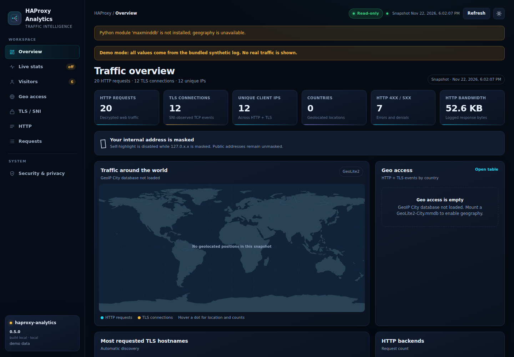
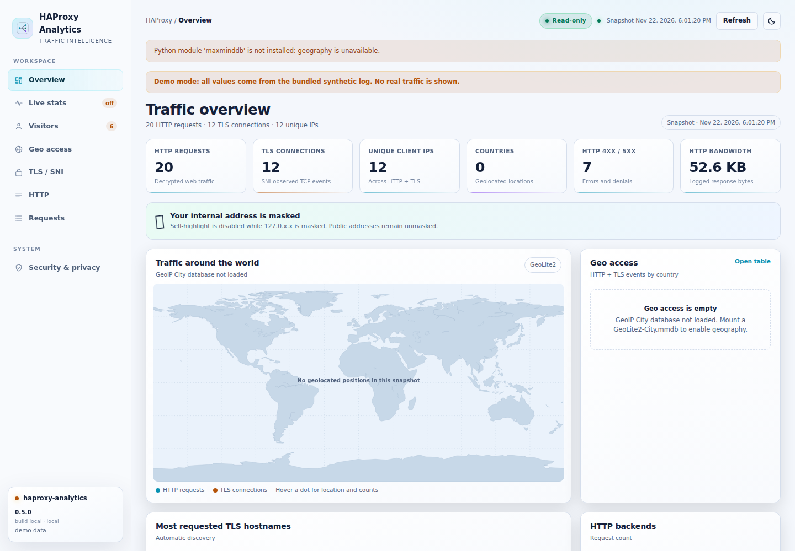

# HAProxy Analytics

[](https://github.com/RogerBergling/haproxy-analytics/actions/workflows/ci.yml)
[](https://github.com/RogerBergling/haproxy-analytics/actions/workflows/docker-publish.yml)
[](https://github.com/RogerBergling/haproxy-analytics/actions/workflows/gitleaks.yml)

**Read-only HAProxy traffic intelligence: HTTP requests, TLS/SNI connections, client geography, ASN networks, live runtime counters and a searchable visitor table — without shipping logs to a third party.**

**Project facts (2026-11-25):** version **0.6.0** · Python 3.11+ standard-library
server + browser SPA · 116 unit tests and an HTTP smoke test · MIT licensed.

HAProxy Analytics is a small self-hosted service. It reads HAProxy logs from a mounted file or an optional syslog receiver, optionally polls a dedicated read-only HAProxy stats socket, enriches client addresses with local MaxMind GeoLite2 databases, and serves a dark, responsive dashboard. The container has no database or upload endpoint. Syslog history is memory-only by default; an optional dedicated data volume persists it across restarts. The browser makes no third-party requests.

> **The dashboard contains client IP addresses, hostnames and requested paths. It has no built-in login.** Run it behind HAProxy with TLS and authentication. The default Compose file binds the published port to `127.0.0.1`.

---

## What it does

- **HTTP analytics** from HAProxy `option httplog` records: requests, bandwidth, methods, status codes, backends and requested paths.
- **TLS/SNI analytics** from a TCP frontend that captures `req.ssl_sni`: hostnames, countries, ASNs and recent connections.
- **Optional live stats** from a dedicated read-only HAProxy stats socket: global runtime counters, frontend/backend/server health, rates, sessions, errors and bytes. The app never sends runtime-control commands.
- **Geo access** view: a world map plus searchable country and city tables, styled to match the other self-hosted apps in this workspace.
- **Requests view**: the newest individual HTTP requests with time, client IP and port, hostname, country/city, method, status, request, bytes, frontend, backend/server and protocol, plus a text filter.
- **Visitor table** grouped by observed client IP: SNI hostnames, HTTP backends, event counts and last-seen time.
- **Internal IP masking** enabled by default: private, loopback and documentation addresses are masked in the dashboard and API; public addresses remain visible.
- **Configurable domain exclusion** for sensitive applications: drop matching SNI hostnames, captured Host headers and absolute-URL hosts before aggregation. Supports multiple domains and subdomains.
- **Domain-only statistics** for applications that need traffic counts without exposing URIs: keep the domain, replace the request path and query string with a domain label, and retain request/status/byte statistics.
- **"This is you"** highlight through the local `/api/whoami` endpoint. Forwarded addresses are trusted only from explicitly configured proxies; internal viewers see a masked notice instead of a highlight.
- **Detailed native HTTP view**: method types, status classes, protocol mix, hourly distribution, bandwidth, and per-IP request/byte/status/path/backend details.
- **Optional syslog receiver** for HAProxy hosts that cannot mount a log file locally. Disabled by default, with a source allowlist and optional TCP TLS/mTLS.
- **Optional persistent syslog history** in a host-mounted data directory, with size rotation and a clear-history action in the dashboard.
- **Graceful degradation**: no MaxMind database and no log file do not crash the dashboard; they produce clear warnings and an empty state.

## Quick start

### Docker Compose

```bash
git clone https://github.com/RogerBergling/haproxy-analytics.git
cd haproxy-analytics
cp .env.example .env
mkdir -p logs geoip data
# Optional persistent syslog history: give the container user write access.
sudo chown 10001:10001 data

# Put the current HAProxy log here (read-only inside the container):
#   logs/haproxy.log
# Optionally place GeoLite2-City.mmdb and GeoLite2-ASN.mmdb in geoip/.

docker compose up -d
```

Open <http://127.0.0.1:8009>. In production, put HAProxy in front of that port for TLS and authentication. See [docs/deployment.md](docs/deployment.md) and [docs/haproxy.md](docs/haproxy.md).

The published image is:

```text
ghcr.io/rogerbergling/haproxy-analytics:latest
```

If GHCR reports the package as private on the first pull, either make it public
under **GitHub → Packages → haproxy-analytics → Package settings**, or
authenticate with a token that has `read:packages`:

```bash
echo "$CR_PAT" | docker login ghcr.io -u YOUR_GITHUB_USERNAME --password-stdin
```

### Try it without logs

```bash
docker run --rm -p 127.0.0.1:8009:8080 \
  -e DEMO_MODE=true -e HAPROXY_LOG_FILE= \
  --read-only --cap-drop=ALL \
  --security-opt=no-new-privileges:true \
  --tmpfs /tmp:rw,noexec,nosuid,size=32m \
  ghcr.io/rogerbergling/haproxy-analytics:latest
```

Or from a checkout:

```bash
make demo
```

The demo uses synthetic `example.com` hostnames and documentation/public resolver addresses. It contains no real user or infrastructure data.

### Local Python

Requires Python 3.11+ and `maxminddb`:

```bash
python3 -m pip install -r requirements.txt
python3 -m haproxy_analytics --demo --bind 127.0.0.1 --port 8080
```

## Architecture

```text
HAProxy log file ──┐
                   ├──> parser ──> in-memory aggregator ──> snapshot JSON
optional syslog ───┘                    │
                                        └──> local GeoLite2 City/ASN lookup
                                                    │
optional HAProxy stats socket ──> live stats cache ─┼──> /api/live
                                                    │
browser <── same-origin HTTP <── Python server <─────┘
   │                              │
   └── /api/whoami (trusted proxy aware)
```

The server never writes to the log source and never sends HAProxy runtime-control commands. It keeps one bounded snapshot and one bounded live-stats payload in memory, rebuilds them on timers, and serves the static dashboard plus a small JSON API. There is no database or queue. The optional syslog store persists received lines in a dedicated data directory; otherwise state is in memory. See [docs/architecture.md](docs/architecture.md).

## Supported HAProxy formats

HTTP records use the standard `option httplog` field order:

```text
203.0.113.10:53124 [18/Nov/2026:00:01:02.123] ft_https bk_app/app1 0/0/1/2/3 200 5120 "GET / HTTP/1.1"
```

TLS/SNI records use a TCP frontend with a custom log format:

```text
src=203.0.113.10 dst=198.51.100.10:443 sni=app.example.com
```

Both syslog-wrapped and plain lines are accepted. Syslog `message repeated N times` groups are expanded. Optional captures such as `capture request header Host len 64` are accepted and used for `EXCLUDED_DOMAINS` matching. See [docs/operations.md](docs/operations.md) for format troubleshooting.

## External HAProxy logs

The log file can be mounted from the HAProxy host, or forwarded from another server. The recommended separate-host options are:

1. **Central rsyslog over TLS** → writes a local HAProxy log → mount it read-only into the container. Best history and operational fit.
2. **Built-in syslog receiver** → HAProxy/rsyslog sends events directly to the app. Useful for a dedicated analytics container; the receiver is memory-only by default, or can persist to a dedicated data volume. It must be protected by a source allowlist and optional TLS.

The complete comparison, forwarding examples and security requirements are in [docs/external-logs.md](docs/external-logs.md).

## Theme modes

`APP_THEME` sets the first-visit theme. The theme toggle saves the visitor's
explicit choice, which overrides this default.

| Value | Behavior |
|---|---|
| `dark` | Dark theme (default) |
| `light` | Light/white theme |
| `system` | Follow the browser/OS `prefers-color-scheme` |

Set it in `.env` or Compose:

```yaml
environment:
  APP_THEME: ${APP_THEME:-dark}
```

Invalid values fall back to `dark`. The default is served by `/theme.js` and
applied before first paint, so there is no theme flash.

## Screenshots

| Dark theme | Light theme |
| --- | --- |
|  |  |

The screenshots use the bundled synthetic demo log. GeoIP is empty because no
MaxMind database is mounted in the demo. Both captures show the 0.5.0 build
badge; the current version is 0.6.0. Regenerate them when a browser is
available.

## Configuration

Copy [`.env.example`](.env.example) to `.env`. The most important settings:

| Variable | Default | Purpose |
| --- | --- | --- |
| `APP_BIND` | `127.0.0.1` | Host interface used by Compose. Keep loopback unless HAProxy is on the same host and you understand the exposure. |
| `APP_PORT` | `8009` | Published host port. The container always listens on 8080 internally. |
| `HAPROXY_LOG_DIR` | `./logs` | Host directory containing the log. Mounted read-only. |
| `HAPROXY_LOG_FILE` | `/logs/haproxy.log` | Log path inside the container. Empty disables file mode. |
| `DATA_DIR` | `./data` | Host directory for optional persistent syslog history, mounted read-write at `/data`. |
| `SYSLOG_STORE_FILE` | empty | Set to `/data/syslog.log` to persist received syslog lines. Empty keeps the receiver memory-only. |
| `SYSLOG_STORE_MAX_BYTES` | `536870912` | Maximum size of the current syslog file before rotation. |
| `SYSLOG_STORE_BACKUPS` | `1` | Number of rotated syslog files kept. |
| `REFRESH_SECONDS` | `60` | Snapshot rebuild interval. |
| `MAX_LOG_BYTES` | `33554432` | Tail window read from the log file. |
| `MASK_INTERNAL_IPS` | `true` | Mask non-global client IPs (private, loopback, documentation) in the dashboard and API. Public IPs remain visible. |
| `MASK_NETWORKS` | empty | Additional CIDRs to mask even if public, for example `192.0.0.0/8,172.0.0.0/8`. |
| `MASK_FULL` | `false` | Use one full mask (`x.x.x.x` / `x:x:x:x:x:x:x:x`) instead of prefix masks. |
| `EXCLUDED_DOMAINS` | empty | Comma-separated domains to drop before aggregation. Matches the domain and all subdomains. HTTP matching needs a captured Host header. |
| `DOMAIN_ONLY_DOMAINS` | empty | Comma-separated domains to keep at domain-only granularity. Request paths and query strings are replaced with the domain; counts remain. Must not overlap or contain an `EXCLUDED_DOMAINS` entry. |
| `HTTP_PATH_MODE` | `full` | `full` keeps request paths; `domain` hides every HTTP path and keeps domain-level statistics. |
| `STRIP_QUERY_STRINGS` | `false` | Remove `?query` strings from every HTTP request path while keeping the path itself. |
| `GEOIP_DIR` | `./geoip` | Host directory containing `GeoLite2-*.mmdb`. |
| `GEOIP_CITY_DB` / `GEOIP_ASN_DB` | `/geoip/...` | Database paths inside the container. |
| `TRUSTED_PROXIES` | empty | Comma-separated proxy IPs/CIDRs allowed to supply `X-Forwarded-For`. |
| `ALLOWED_HOSTS` | empty | Extra DNS hostnames accepted in the HTTP `Host` header. IP literals, single-label names and `*.local`/`*.lan`/`*.home.arpa`/`*.internal` work without this. |
| `SYSLOG_BUFFER_BYTES` | `67108864` | Total byte cap for the in-memory syslog ring. |
| `SYSLOG_MAX_THREADS` | `64` | Maximum concurrent syslog request threads. |
| `HAPROXY_STATS_SOCKET` | empty | Optional read-only HAProxy stats socket as `host:port`. Empty disables Live stats. |
| `STATS_REFRESH_SECONDS` | `5` | Live stats poll interval. |
| `STATS_TIMEOUT_SECONDS` | `2` | Live stats connect and read timeout. |
| `STATS_MAX_BYTES` | `4194304` | Maximum runtime API response size. |
| `STATS_MAX_ROWS` | `500` | Maximum rows per frontend/backend/server table. |
| `SYSLOG_LISTEN` | empty | Optional `host:port` syslog listener. Empty disables it. |
| `MAX_REQUEST_ROWS` | `2000` | Newest individual HTTP requests retained for the Requests view and API. |
| `SYSLOG_ALLOWED_NETWORKS` | `127.0.0.0/8,::1/128` | Source allowlist for the syslog receiver. |
| `SYSLOG_TLS_CERT` / `SYSLOG_TLS_KEY` | empty | Optional TCP TLS certificate and key. |
| `DEMO_MODE` | `false` | Use the bundled synthetic log. |

The full reference is in [docs/deployment.md](docs/deployment.md). Never commit the resulting `.env`, logs, GeoIP databases or certificates.

Internal addresses are masked by default. With `MASK_FULL=true` all masked clients collapse into one `x.x.x.x` row, so per-IP HTTP detail is lost. To see individual private IPs, set `MASK_INTERNAL_IPS=false`, clear `MASK_NETWORKS` and set `MASK_FULL=false`, then restart. Keep the dashboard behind the authenticated HAProxy frontend.

`EXCLUDED_DOMAINS` drops matching HTTP/TLS events before aggregation. `DOMAIN_ONLY_DOMAINS` instead keeps the event and replaces the request path/query with a domain label such as `sendpass.example.com/` or `https://sendpass.example.com/`, so request, status and byte counts remain. `HTTP_PATH_MODE=domain` applies the same domain-only treatment to every HTTP request. `STRIP_QUERY_STRINGS=true` keeps the path but removes every `?query` string. TLS events match on SNI. HTTP events match on a captured `Host` header or an absolute request URL; add `capture request header Host len 64` to the HAProxy frontend for ordinary HTTP requests. All of these modes filter the dashboard/API only: raw logs, rotated files and the persistent syslog store are not redacted.

## Security model

- **No built-in login.** HAProxy must terminate TLS and authenticate the dashboard.
- **Loopback by default.** Compose publishes `127.0.0.1:8009`, not a public interface.
- **Read-only root filesystem.** Non-root user, read-only root, all capabilities dropped, `no-new-privileges`, small `/tmp` tmpfs. The optional syslog history writes only to its dedicated data volume.
- **No third-party browser requests.** No CDN, external fonts, analytics, map tiles or IP-lookup service. A strict CSP blocks outbound connections.
- **A local GeoIP lookup.** MaxMind databases are mounted files; client IPs are never sent to MaxMind or anyone else.
- **Read-only runtime access.** The optional Live stats view connects to a dedicated HAProxy stats socket at `level user` and only sends `show info;show stat`. Bind the socket to a private interface and firewall it to the analytics host; HAProxy stats sockets have no TLS or authentication of their own. Never expose the socket or reuse the admin socket.
- **Explicit proxy trust.** `X-Forwarded-For` is ignored unless the immediate peer is in `TRUSTED_PROXIES`.
- **Host allowlist.** Unknown `Host` headers are rejected to block DNS-rebinding reads. IP literals and local names work by default; set `ALLOWED_HOSTS` for a public DNS name.
- **Internal IP masking.** Private/internal addresses are masked by default in the dashboard and API; public addresses remain visible.
- **Domain and path privacy.** `EXCLUDED_DOMAINS` drops matching HTTP and TLS events. `DOMAIN_ONLY_DOMAINS` keeps selected domains at domain-only granularity. `HTTP_PATH_MODE=domain` hides every HTTP path while keeping domain/status/byte counts, and `STRIP_QUERY_STRINGS=true` removes query strings globally. None of these modes redact the source log or persistent syslog store.
- **Bounded inputs.** Log tail size, visitor rows, individual request rows, syslog message size, total syslog buffer bytes, syslog worker threads, HTTP workers and per-snapshot aggregation cardinality (IPs, paths, SNIs and backends) are all capped. Excess keys collapse into one `(other)` bucket.
- **Private persistent syslog history.** The optional syslog store is created with mode `0600` in a `0700` directory; it contains client IPs, hostnames and paths.
- **HTTP server limits.** The dashboard server has a 15-second socket timeout and a 32-connection worker cap, so a slowloris-style client cannot pin unbounded threads.
- **No embedded third-party report.** HTTP analytics are rendered natively from parsed events; there is no report iframe or external script.
- **Secret scanning.** Gitleaks runs in CI. The repository contains only synthetic demo data.

### Verify the deployment is actually protected

The app cannot enforce the reverse proxy's login. After deployment, check that
the snapshot API is not publicly readable:

```bash
curl -s -o /dev/null -w '%{http_code}\n' https://your-host/api/snapshot
```

Expect `401`, `403` or a login redirect — **not** `200`. A `200` response means
client IPs, hostnames, paths and possibly query data are exposed. Put the
dashboard behind HAProxy authentication or stop the listener immediately.

Read [SECURITY.md](SECURITY.md) and [docs/security.md](docs/security.md) before exposing the dashboard.

## Documentation

| Document | Contents |
| --- | --- |
| [Architecture](docs/architecture.md) | Components, data flow and design decisions. |
| [Deployment](docs/deployment.md) | Compose, `.env`, volumes, permissions, upgrades and troubleshooting. |
| [HAProxy configuration](docs/haproxy.md) | TLS termination, HTTP logging, SNI capture and an authenticated dashboard frontend. |
| [External logs](docs/external-logs.md) | File mounts, rsyslog over TLS and the built-in syslog receiver. |
| [GeoIP](docs/geoip.md) | MaxMind databases, optional updater and privacy notes. |
| [Security](docs/security.md) | Threat model, trust boundaries, data handling and operator checklist. |
| [Operations](docs/operations.md) | Runbook, parser troubleshooting, performance and log rotation. |
| [Development](docs/development.md) | Layout, tests, validation and contribution rules. |

Ready-to-adapt examples are in [`examples/haproxy/`](examples/haproxy/) and [`examples/rsyslog/`](examples/rsyslog/). They use `example.com`, documentation addresses and placeholders only.

## Development and validation

```bash
make test       # unit tests
make verify     # repository/private-data/security checks
make smoke      # real server with demo data and HTTP contract checks
make validate   # compile + test + verify + smoke
```

The CI workflow runs tests on Python 3.11 and 3.12, verifies the repository, runs the smoke test and builds the Docker image. The publish workflow builds `linux/amd64` and `linux/arm64` and pushes to GHCR.

## Repository hygiene

- The local `target/` reproduction bundle is **ignored** and must never be
  force-added. It contains the original server-specific notes.
- Real logs, `.env`, persistent syslog data, MaxMind databases, certificates
  and private HAProxy configurations are ignored by default.
- `scripts/verify.py` rejects common private-address and private-domain tokens,
  checks container hardening and checks the dashboard for unsafe HTML patterns.
- Gitleaks scans the full history in CI. Review the diff before publishing.
- If you use the local `git-create` workflow, run it as an additional check
  before pushing.

## Non-goals

- Terminating TLS inside this app. Use HAProxy.
- Decrypting TLS passthrough traffic. SNI analytics observes ClientHello metadata only.
- Replacing a SIEM, long-term log store or intrusion detection system.
- Replacing a central log store or building a long-term multi-node archive.
- Changing HAProxy runtime state (enable/disable servers, weights or sessions). Live stats are read-only.
- Sending analytics, GeoIP lookups or telemetry to a third party.

## AI assistance

Developed with AI assistance and human review. The maintainer defines the
requirements, threat model and acceptance criteria; AI helps write and refactor
code; the maintainer runs, tests and verifies the result. The software is
provided as-is, without warranty.

## License

MIT. See [LICENSE](LICENSE).

See [THIRD_PARTY_NOTICES.md](THIRD_PARTY_NOTICES.md) for component notices.

This is an independent self-hosted tool, not official HAProxy or MaxMind software. HAProxy and MaxMind have their own licenses and trademarks.
